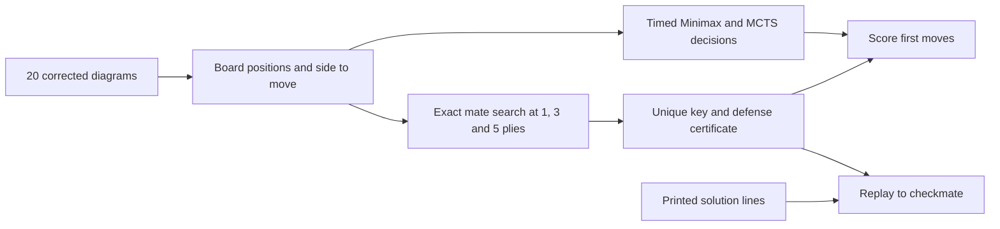
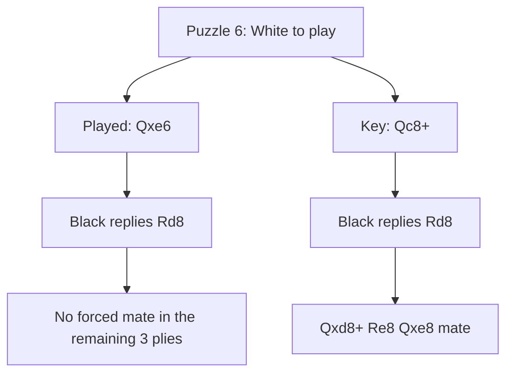

# MURL Chess · Finding the first move in a forced mate

Fall 2026 · University of Illinois Chicago · MATH 496

On 20 course-supplied chess problems, how quickly do Minimax and Monte Carlo tree search (MCTS) return a move, how often is it the unique key to mate in three, and what goes wrong when they miss it? This repository contains Akbar Aman's experimental contribution to the group poster coordinated by La Min Aung.

**[Read the comprehensive report](Reports/MURL_Chess_Research.pdf)** · **[Open the poster handoff](deliverables/november05/README.md)** · **[Browse all three reports](Reports/README.md)**

### Where to start

| If you need… | Open… |
|---|---|
| A figure or paragraph for the group poster | [Poster handoff with captions and editable vector figures](deliverables/november05/README.md) |
| The original submissions | [September 23 PDF](Reports/MURL_report_9_23.pdf) · [October 14 PDF](Reports/MURL_Report_10_14.pdf) |
| Each puzzle's correct and actual algorithm moves | [20-row comparison](deliverables/october14/RESULTS_SUMMARY.md) · [CSV with FENs and times](deliverables/october14/results/summary.csv) |
| Source diagrams, solutions, prior poster template and minutes | [Source register](deliverables/november05/sources/README.md) |
| The new shared-time experiment | [Four-condition summary](deliverables/november05/data/budget_summary.csv) · [all 160 decisions](deliverables/november05/data/budget.csv) |

## RQ1 · Execution time

September measured eight varied boards. At depth three, two positions with 16 pieces took 0.087 and 3.586 seconds at the median. The first had 15 legal first moves and 2,978 visited nodes; the second had 53 moves and 123,342 nodes. Piece count alone concealed a large difference in work. [September measurements](results/summary.csv)

October tested the same corrected 20 puzzles for both algorithms, with a safety limit of 20 s per call.

| October workload | Calls finished | Key hits among finished | Median seconds among finished |
|---|---:|---:|---:|
| Plain Minimax, 3 plies | 20/20 | 6/20 | 0.535 |
| Plain Minimax, 5 plies | 2/20 | 2/2 | 8.195 |
| UCT MCTS, 1,000 simulations, seeds 0/1/2 | 60/60 | 9/60 | 2.724 |


Five-ply Minimax finished on puzzles 16 and 18. Eighteen calls timed out. Eight timeout moves matched the key, but their full-depth runtime is unknown. A shared safety ceiling does not make fixed-depth and fixed-iteration workloads equal.

## RQ2 · Which first moves were accurate?

A **key** is a move that forces checkmate against every legal defense within five plies. Matching the key scores one correct first decision. Solving the continuation requires separate evidence. Three-ply Minimax matched six keys. Each MCTS seed matched three, with five distinct puzzles hit across the seeds. All 20 printed first moves agree with the exact search.



The exact verifier tries every legal first move. At attacker nodes one winning continuation suffices; at defender nodes every legal reply must permit the mate. All 20 positions have a unique five-ply key and no shorter forced mate. The verifier and both search programs share python-chess for legality. [Verifier code](experiments/october14/oracle.py) · [Strategy certificates](deliverables/october14/results/mate_certificates.json)

**Position 18.** After **Rxg7 Kf8 Ne6+ Ke8**, the printed **c8=R#** and October sample **c8=Q#** both checkmate. The printed explanation that a queen stalemates is incorrect on the supplied board. Bishop and knight promotions do stalemate. Across all 20 puzzles, 13 printed lines differ from the stored sample but every printed line legally ends in mate. [Move-by-move audit](deliverables/november05/data/solutions.json)

## RQ3 · Why did the search miss the mate?


| Puzzle | Recorded move | Correct key | A defense against the recorded move |
|---|---|---|---|
| 6 · back rank | **Qxe6**, all three MCTS seeds | **Qc8+** | **...Rd8** removes White's forced mate in the remaining three plies. Against Qc8+ the same reply allows Qxd8+ Re8 Qxe8#. |
| 13 · rook lift | **Kxd1**, three-ply Minimax and all MCTS seeds | **Nf6** | **...Kg8** prevents mate within the remaining horizon. |
| 16 · promotion | **Kg4**, three-ply Minimax | **Rf7** | **...Kg8** defeats the short mate. Five-ply Minimax finished in 10.012 s and selected Rf7. |

For puzzle 6, seed 0 visited Qxe6 **88** times and Qc8+ **56** times. MCTS returns the most visited root move. Of its 1,000 rollouts, 881 reached the evaluation cutoff. This explains the final choice under the recorded policy. A different reward or rollout policy would require a separate intervention to establish its effect. [Defensive witnesses](deliverables/november05/data/defenses.json) · [Raw visits and scores](deliverables/october14/results/run1/raw.jsonl)



### November sensitivity experiment

Every puzzle received both time ceilings. Plain Minimax targeted three plies. MCTS targeted 100,000 iterations, with a 40-ply rollout cap, so the clock determined the usable sample. All 160 calls ran serially in shuffled order (seed 496). This comparison scores the decision actually available at the deadline. Minimax can finish early, and partial searches may return the best finished branch or first legal fallback.

| Ceiling | Minimax returned keys | Minimax finished | MCTS returned keys | Median MCTS simulations |
|---|---:|---:|---:|---:|
| 0.25 s | 4/20 | 4/20 | 3/60 | 90 |
| 1.00 s | 5/20 | 15/20 | 6/60 | 341 |

One of the four finished short-ceiling Minimax calls matched the key. At one second five of 15 finished calls matched. All MCTS calls stopped before the requested iteration target. Time limits are shared ceilings, not identical realized runtimes. [Raw decisions](deliverables/november05/data/budget.csv) · [Machine and versions](deliverables/november05/data/environment.json)

## Reproduce the checks

From the repository root, create and activate a Python 3.12 environment. Install the search, plotting, and source-audit dependencies.

```sh
python -m venv .venv
# Windows PowerShell: .\.venv\Scripts\Activate.ps1
# macOS/Linux: source .venv/bin/activate
python -m pip install -r requirements.txt -r experiments/october14/requirements.txt
python -m unittest discover -s tests -v
python -m experiments.october14.audit --output-dir tmp/october-audit
python -m experiments.november05.evidence --output tmp/solution-audit
python -m experiments.november05.replay
python -m experiments.november05.summary deliverables/november05/data
```

The October audit verifies source hashes, all 1,280 board squares, raw records, legal moves, root coverage, and completion flags. The November source audit reads the printed solution pages, checks all certificates, compares the two position 18 promotions, and computes a defensive witness for each featured error.

```sh
# Use fresh output directories for new timing runs.
python -m experiments.november05.budgets --output tmp/new-budget
python -m experiments.november05.summary tmp/new-budget
python -m experiments.october14.run --output tmp/new-october
python -m experiments.october14.audit --run-dir tmp/new-october --output-dir tmp/new-october-tables
python -m experiments.november05.figures
```

The October full run includes 60 verifier calls and 100 algorithm calls. Use the archived evidence for the published measurements. Runtime, cutoff moves, and completed work under a clock vary across machines and reruns. To rebuild the November PDF with Tectonic, run `tectonic MURL_Chess_Research.tex` from `Reports/`. The source includes the versioned PNGs.

## Repository map and scope

| Path | Contents |
|---|---|
| [Reports](Reports/) | All submitted PDFs plus the consolidated report and its source |
| [November deliverables](deliverables/november05/) | Poster materials, solution replay, defensive witnesses, original source register, and shared-time measurements |
| [October archive](deliverables/october14/) | Corrected boards, report, calls, settings, certificates, and original audits |
| [Search code](src/) · [experiments](experiments/) · [tests](tests/) | Minimax, UCT, evaluation, benchmark drivers, and regression checks |
| [September results](results/) · [September source](report/) | Eight-board measurements and original report build |
| [References](references.bib) | Algorithm and software sources |

These are selected mate-in-three compositions with one Black-to-move position. Root mobility describes one layer of the search tree. Three seeds are repeated trials on the same positions. Hardware, clock checks, fallback ordering, and the material evaluation affect behavior. No tournament-strength ranking or group-wide consensus follows from this contribution.

The historical September and October measurements are preserved. The November work adds a source cross-check, a new experiment, and a synthesis for the group's Nov 5 findings deadline.
