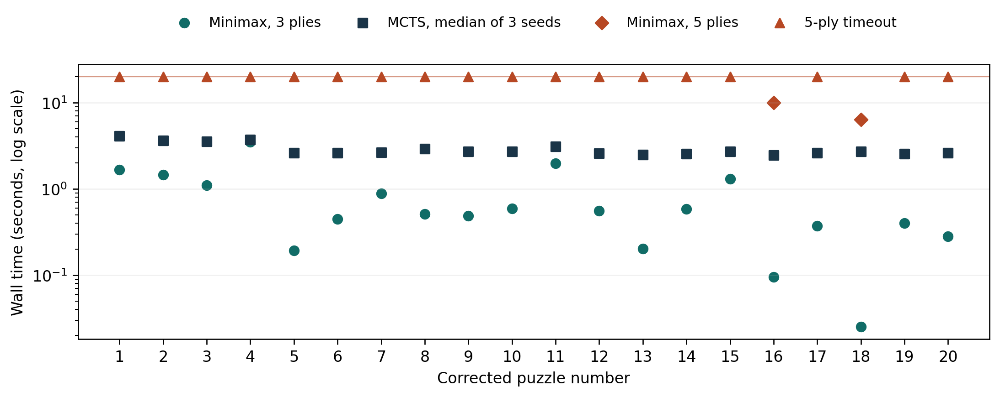
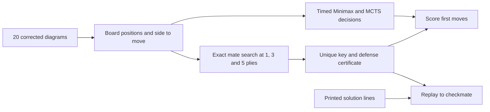
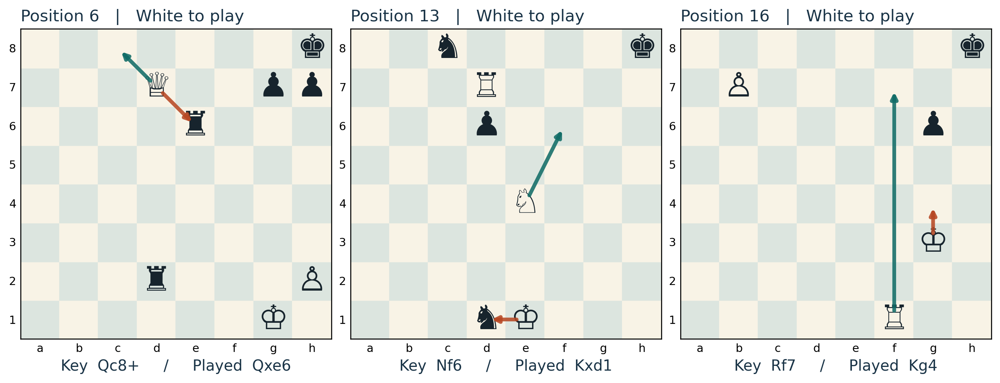
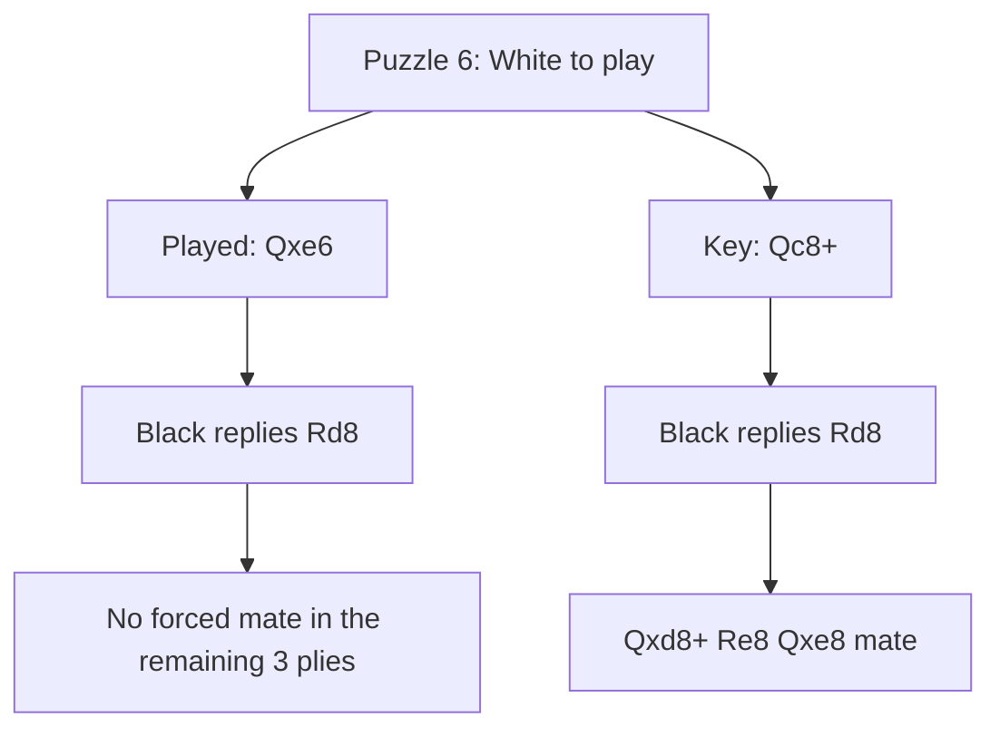

# MURL Chess · Finding the first move in a forced mate

Fall 2026 · University of Illinois Chicago · MATH 496

I investigated how quickly Minimax and Monte Carlo tree search (MCTS) return a move on 20 course-supplied problems, how often they select the unique key to mate in three, and what happens when they miss it. I am sharing my measurements, code, and analysis with our group for the poster coordinated by La Min Aung.

**[My concise group findings](Reports/MURL_Chess_Group_Findings.pdf)** · **[Google Doc](https://docs.google.com/document/d/10VYO_vFpFaVLsv9ceS01ASPTvwlAWUAKpZGiy-NSOWQ)** · **[Comprehensive report](Reports/MURL_Chess_Research.pdf)** · **[All reports](Reports/README.md)**

### Where to start

| Material I am sharing | Location |
|---|---|
| A figure or paragraph for the group poster | [Poster handoff with captions and editable vector figures](deliverables/november05/README.md) |
| The original submissions | [September 23 PDF](Reports/MURL_report_9_23.pdf) · [October 14 PDF](Reports/MURL_Report_10_14.pdf) |
| Each puzzle's correct and actual algorithm moves | [20-row comparison](deliverables/october14/RESULTS_SUMMARY.md) · [CSV with FENs and times](deliverables/october14/results/summary.csv) |
| Source diagrams, solutions, prior poster template and minutes | [Source register](deliverables/november05/sources/README.md) |
| The new shared-time experiment | [Four-condition summary](deliverables/november05/data/budget_summary.csv) · [all 160 decisions](deliverables/november05/data/budget.csv) |

## RQ1 · Execution time

In September, I measured eight varied boards. At depth three, two positions with 16 pieces took 0.087 and 3.586 seconds at the median. I recorded 15 legal first moves and 2,978 visited nodes for the first, versus 53 moves and 123,342 nodes for the second. I found that piece count alone concealed a large difference in work. [My September measurements](results/summary.csv)

In October, I tested both algorithms on the same corrected 20 puzzles, with a safety limit of 20 s per call.

| October workload | Calls finished | Key hits among finished | Median seconds among finished |
|---|---:|---:|---:|
| Plain Minimax, 3 plies | 20/20 | 6/20 | 0.535 |
| Plain Minimax, 5 plies | 2/20 | 2/2 | 8.195 |
| UCT MCTS, 1,000 simulations, seeds 0/1/2 | 60/60 | 9/60 | 2.724 |



My five-ply Minimax runs finished on puzzles 16 and 18. I stopped eighteen calls at the time limit. Eight timeout moves matched the key, while their full-depth runtime remains unknown. I interpret these measurements within their different requested workloads.

## RQ2 · Which first moves were accurate?

I define a **key** as a move that forces checkmate against every legal defense within five plies. I score agreement with that key as a correct first decision and verify the continuation separately. I recorded six matches for three-ply Minimax and three for each MCTS seed, with five distinct puzzles hit across the seeds. I also checked that all 20 printed first moves agree with my exact search.



I used an exact verifier that tries every legal first move. One winning continuation suffices at attacker nodes, while every legal reply must permit the mate at defender nodes. I found a unique five-ply key and no shorter forced mate in all 20 positions. My verifier and both search programs share python-chess for legality. [My verifier](experiments/october14/oracle.py) · [Strategy certificates](deliverables/october14/results/mate_certificates.json)

**My position 18 check.** After **Rxg7 Kf8 Ne6+ Ke8**, I verified that the printed **c8=R#** and my October sample **c8=Q#** both checkmate. The booklet's queen-stalemate explanation is incorrect on this board. I found stalemate after bishop and knight promotion. Across all 20 puzzles, I replayed 13 printed lines that differ from my sample, and every printed line legally ended in mate. [My move-by-move audit](deliverables/november05/data/solutions.json)

## RQ3 · Why did the search miss the mate?



| Puzzle | Recorded move | Correct key | A defense against the recorded move |
|---|---|---|---|
| 6 · back rank | **Qxe6**, all three MCTS seeds | **Qc8+** | **...Rd8** removes White's forced mate in the remaining three plies. Against Qc8+ the same reply allows Qxd8+ Re8 Qxe8#. |
| 13 · rook lift | **Kxd1**, three-ply Minimax and all MCTS seeds | **Nf6** | **...Kg8** prevents mate within the remaining horizon. |
| 16 · promotion | **Kg4**, three-ply Minimax | **Rf7** | **...Kg8** defeats the short mate. Five-ply Minimax finished in 10.012 s and selected Rf7. |

For puzzle 6, I recorded **88** visits to Qxe6 and **56** to Qc8+ at seed 0. My MCTS implementation returns the most visited root move. Of its 1,000 rollouts, 881 reached the evaluation cutoff. I can explain the final choice from these records. I would need a separate intervention to establish the effect of changing the reward or rollout policy. [My defensive witnesses](deliverables/november05/data/defenses.json) · [Raw visits and scores](deliverables/october14/results/run1/raw.jsonl)



### November sensitivity experiment

I applied both time ceilings to every puzzle. I requested three plies for plain Minimax and 100,000 iterations for MCTS, with a 40-ply rollout cap, so the clock determined its usable sample. I ran all 160 calls serially in shuffled order with seed 496 and scored the decision available at the deadline. My Minimax code can finish early and returns its best finished branch or first legal fallback on timeout.

| Ceiling | Minimax returned keys | Minimax finished | MCTS returned keys | Median MCTS simulations |
|---|---:|---:|---:|---:|
| 0.25 s | 4/20 | 4/20 | 3/60 | 90 |
| 1.00 s | 5/20 | 15/20 | 6/60 | 341 |

I recorded one key match among the four finished short-ceiling Minimax calls and five among the 15 finished one-second calls. Every MCTS call stopped before its requested target. I used shared ceilings while allowing actual elapsed times to differ. [My raw decisions](deliverables/november05/data/budget.csv) · [Machine and versions](deliverables/november05/data/environment.json)

## Reproduce the checks

I used Python 3.12 and the pinned dependencies below. The following commands reproduce my checks from the repository root.

```sh
python -m venv .venv
# Windows PowerShell: .\.venv\Scripts\Activate.ps1
# macOS/Linux: source .venv/bin/activate
python -m pip install -r requirements.txt -r experiments/october14/requirements.txt
python -m unittest discover -s tests -v
python -m experiments.october14.audit --output-dir tmp/october-audit
python -m experiments.november05.evidence --output tmp/solution-audit
python -m experiments.november05.replay
python -m experiments.november05.summary deliverables/november05/data
```

My October audit verifies source hashes, all 1,280 board squares, raw records, legal moves, root coverage, and completion flags. My November audit reads the printed solutions, checks the certificates, compares the position 18 promotions, and computes a defensive witness for each featured error.

```sh
# Use fresh output directories for new timing runs.
python -m experiments.november05.budgets --output tmp/new-budget
python -m experiments.november05.summary tmp/new-budget
python -m experiments.october14.run --output tmp/new-october
python -m experiments.october14.audit --run-dir tmp/new-october --output-dir tmp/new-october-tables
python -m experiments.november05.figures
```

The October full run includes 60 verifier calls and 100 algorithm calls. Use the archived evidence for the published measurements. Runtime, cutoff moves, and completed work under a clock vary across machines and reruns. To rebuild the November PDF with Tectonic, run `tectonic MURL_Chess_Research.tex` from `Reports/`. The source includes the versioned PNGs.

## Repository map and scope

| Path | Contents |
|---|---|
| [Reports](Reports/) | All submitted PDFs plus the consolidated report and its source |
| [November deliverables](deliverables/november05/) | Poster materials, solution replay, defensive witnesses, original source register, and shared-time measurements |
| [October archive](deliverables/october14/) | Corrected boards, report, calls, settings, certificates, and original audits |
| [Search code](src/) · [experiments](experiments/) · [tests](tests/) | Minimax, UCT, evaluation, benchmark drivers, and regression checks |
| [September results](results/) · [September source](report/) | Eight-board measurements and original report build |
| [References](references.bib) | Algorithm and software sources |

I tested selected mate-in-three compositions with one Black-to-move position. I use root mobility to describe one layer and interpret the three seeds as repeated trials on the same boards. Hardware, clock checks, fallback ordering, and material evaluation affect my results. I limit my conclusions to this experimental scope.

I have retained my dated September and October artifacts and added the November source checks, experiment, and synthesis for our Nov 5 handoff. I describe the tools and sources I used in my [preparation and provenance note](docs/provenance.md).
